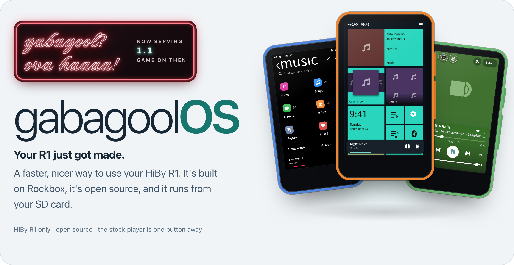
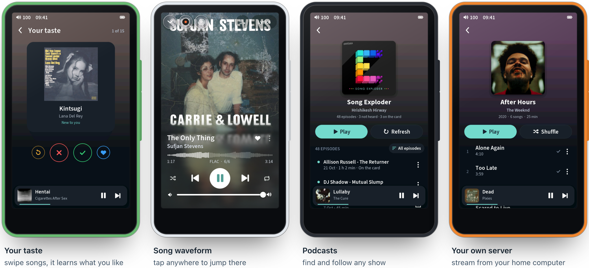
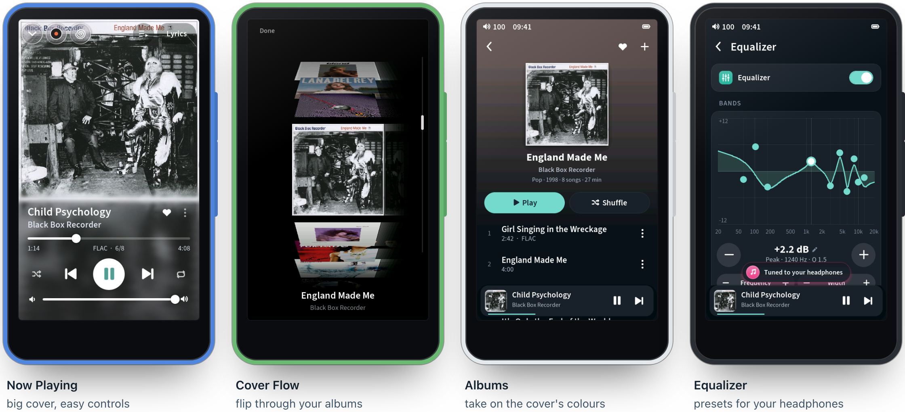

<a href="https://github.com/BlueDreams666/gabagoolOS/releases/latest">
<picture>
  <source media="(prefers-color-scheme: dark)" srcset="assets/hero-dark.png">
  
</picture>
</a>

**[Download 1.1](https://github.com/BlueDreams666/gabagoolOS/releases/latest)** &nbsp;·&nbsp;
[How to install](#no-funny-business) &nbsp;·&nbsp;
[Questions](#you-got-questions)

We love the HiBy R1. It's tiny, it sounds great, and it was cheap. The software
it ships with, less so. So we made our own.

GabagoolOS gives the R1 a new interface from top to bottom. Your library stays
smooth even with tens of thousands of songs, lyrics scroll along with the music,
and there's a proper equalizer, internet radio, podcasts, audiobooks and e-books.
It runs from the SD card and never touches your music files. If you ever want the
stock HiBy player back, it's one button away.

## made fresh daily

The stuff you use every day, made fast and easy to get to.

<picture>
  <source media="(prefers-color-scheme: dark)" srcset="assets/fresh-dark.png">
  
</picture>

<picture>
  <source media="(prefers-color-scheme: dark)" srcset="assets/menu-dark.png">
  
</picture>

There are games too, if you want them: 2048, Sudoku, Snake, chess, a little pet,
a music quiz, and Doom and Game Boy games (bring your own cartridges). None of it
runs unless you open it, and you can hide all of it.

## the house special

## today's specials

What's new in 1.1. Swipe through songs and it figures out what you like. See
the whole song as a waveform and jump anywhere in it. Podcasts, e-books, your own
Navidrome or Audiobookshelf server, Last.fm scrobbling, a control centre you can
rearrange, and a phone remote that pairs with a code.

<picture>
  <source media="(prefers-color-scheme: dark)" srcset="assets/case-new-dark.png">
  
</picture>

## from the display case

These are real screens, not mock-ups. Each one is captured at the R1's own
480 × 800 by the same tool we test with.

<picture>
  <source media="(prefers-color-scheme: dark)" srcset="assets/case-homes-dark.png">
  
</picture>

<picture>
  <source media="(prefers-color-scheme: dark)" srcset="assets/case-listen-dark.png">
  
</picture>

<picture>
  <source media="(prefers-color-scheme: dark)" srcset="assets/case-more-dark.png">
  
</picture>

## we keep the books

We built it with AI help, so we test it hard. And we use it every day on our own two R1s.

<picture>
  <source media="(prefers-color-scheme: dark)" srcset="assets/books-dark.png">
  
</picture>

## no funny business

Each [release](https://github.com/BlueDreams666/gabagoolOS/releases/latest)
comes with a full guide that explains every step and every file. Please read it
before you flash anything. The short version:

1. **Get ready.** Charge to at least 50% and back up your card. Download HiBy's
   official R1 firmware from their help centre too. That's your way back.
2. **Install the boot menu (just once).** Move any other `.upt` files off the
   card. Copy `GabagoolOS-1.1-boot-menu.upt` to the top of the card and rename it
   `r1.upt`. Then, in the HiBy player, go to System > Firmware update > Via SD card.
3. **Copy GabagoolOS over.** Unzip `GabagoolOS-1.1-HiBy-R1.zip` onto the top of
   the card (you'll get a hidden `.rockbox` folder and a `Games` folder), then restart.

From then on the R1 starts straight into GabagoolOS. To use the HiBy player
instead, **hold Volume Down while you turn it on**.

### changed your mind? forget about it

1. Copy HiBy's official 2.0 or 1.6 firmware to the top of the card as `r1.upt`.
2. Hold Volume Down while you turn the R1 on, open the HiBy player, and go to
   System > Firmware update > Via SD card.
3. Delete the `.rockbox` folder if you want the space back. Your music stays put.

## you got questions?

<b>Is it Rockbox?</b>

 

Underneath, yes. [Rockbox](https://www.rockbox.org) has been running on music
players for over twenty years, and it still does the playback, the file formats,
the sound processing and the library. GabagoolOS is the touch interface on top,
plus a lot of R1-specific work. We started from WillNHT's R1 port and bahusoid's
Audiobook Mod. Same licence as Rockbox: GPL v2 or later.

<b>Was it made with AI?</b>

 

Yes, a lot of it. We decided what to build, reviewed it, and tested it on our
own R1s every day. We'd rather tell you than have you wonder. What matters is
whether it works, so here's how we check:

- **Every screen, every way.** A tool opens all 32,256 combinations of screen,
  theme, language and text size and flags anything cut off, overlapping, too
  faint or too small to tap. Right now it finds nothing.
- **Monkey tests.** Thousands of random taps, swipes and button presses on every
  screen, looking for crashes and freezes.
- **Memory checks.** The whole interface runs under a memory checker
  (AddressSanitizer), so memory bugs get caught on a Mac, not on your player.
- **EQ maths.** The equalizer is checked against Rockbox's original filters at
  four sample rates.

All the code will be here for anyone to read.

<b>Why "gabagool"?</b>

 

It's capicola, the way they say it in *The Sopranos*. Tap the house special
tile on the Tiles home. Ova haaaa!

<b>Is it safe to install?</b>

 

As safe as flashing firmware gets. GabagoolOS lives on the SD card in a
`.rockbox` folder and never writes to the R1's internal memory. The boot menu is
HiBy's own 2.0 update with three small things added: the menu itself, a script
that mounts the card, and a boot logo. The kernel inside is HiBy's, byte for
byte, there's no bootloader or recovery image in it, and HiBy's own updater
installs it.

A few more things we were careful about. While the R1 is plugged into a computer,
GabagoolOS doesn't write to the card at all. Updates on the player only install
if they're signed by us. Still, flashing always carries some risk, so keep HiBy's
official file somewhere safe.

<b>Which players does it support?</b>

 

Just the HiBy R1. It's made for the R1's screen, buttons and hardware. Newer
R1s have a different wireless chip (the AIC8800). They should work through
HiBy 2.0's own drivers, but we haven't had one to try yet. If you have one,
please tell us how it goes. Everything apart from Wi-Fi and Bluetooth works the
same either way.

<b>Does it phone home?</b>

 

No. It only goes online when you turn on Wi-Fi and use something that needs it:
lyrics (LRCLIB), covers (MusicBrainz and the Cover Art Archive), internet radio
(radio-browser, and ip-api.com for "near you"), podcasts (Apple's directory and
the feeds you add), AutoEq profiles (GitHub), scrobbling (Last.fm or
ListenBrainz, your own account), your own Navidrome or Audiobookshelf server,
and the clock (NTP). The phone remote only answers phones you've paired.

<b>Something went wrong. What should I send?</b>

 

Sorry about that! [Open an issue](https://github.com/BlueDreams666/gabagoolOS/issues/new/choose)
and tell us which HiBy firmware you're on (1.6 or 2.0, it's in the boot menu)
and which GabagoolOS version you have. Attach `.rockbox/sloppy/sloppy.log` from
the card too. It tells us what the player was doing.

## the family

None of this would exist without these people and projects:

- **[Rockbox](https://www.rockbox.org)** (GPL v2+): playback, codecs, DSP, the
  database, plugins, Doom and the Game Boy core.
- **[Rockbox for the HiBy R1](https://github.com/WillNHT/rockbox-hiby-r1)** by
  WillNHT, built on **[bahusoid's Rockbox Audiobook Mod](https://github.com/bahusoid/rockbox)**:
  the R1 port, the audiobook library and many device fixes.
- **[LVGL](https://lvgl.io)** (MIT), which draws the interface, with lodepng
  (zlib) and stb_image. For internet radio, **libmad** and **FAAD2** (GPL), and
  Rockbox's copies of **Tremor** and **libopus** (BSD) and its FLAC decoder
  (LGPL).
- Fonts under the SIL Open Font License: **Source Sans 3**, **Shrikhand**,
  **Noto Sans** Hebrew, Arabic, SC, KR and Thai, and **Montserrat** for symbols.
- **LRCLIB** for lyrics, **MusicBrainz** and the **Cover Art Archive** for
  covers, **radio-browser** for stations, **AutoEq** by Jaakko Pasanen for
  headphone profiles, **Last.fm** and **ListenBrainz**, and the **Unicode
  Unihan** database for the pinyin keyboard.

Everything, with licences, is in [NOTICE.md](NOTICE.md).

## licence

GabagoolOS is free software under the GNU General Public License, version 2 or
(at your option) any later version, like Rockbox. See [LICENSE](LICENSE).

 

  GabagoolOS is a fan project. It is not made or supported by HiBy, and has nothing to do with HBO or <i>The Sopranos</i>. 
  Flashing firmware is at your own risk; keep HiBy's official file to hand.

