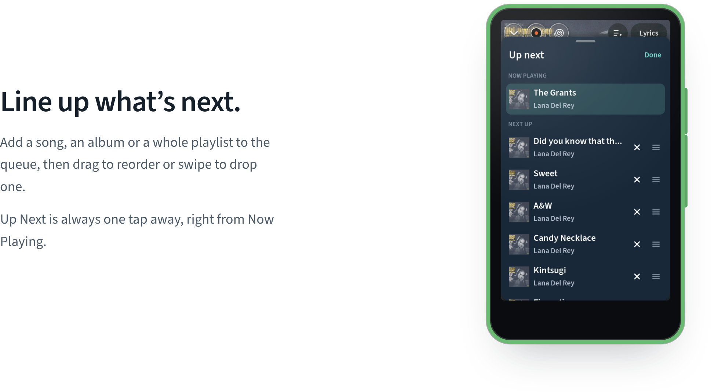
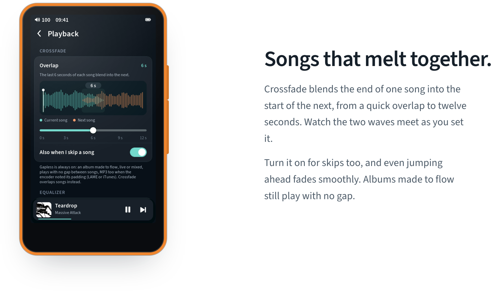
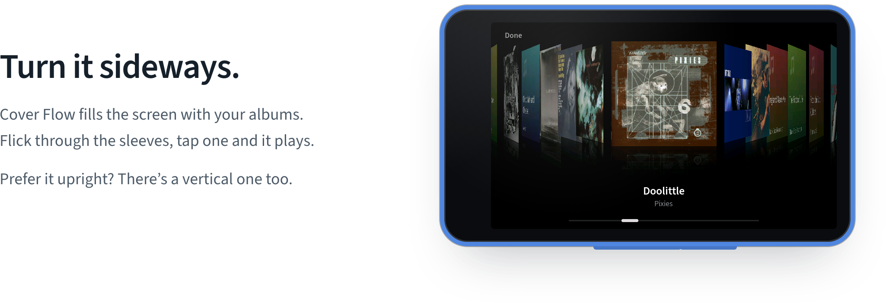
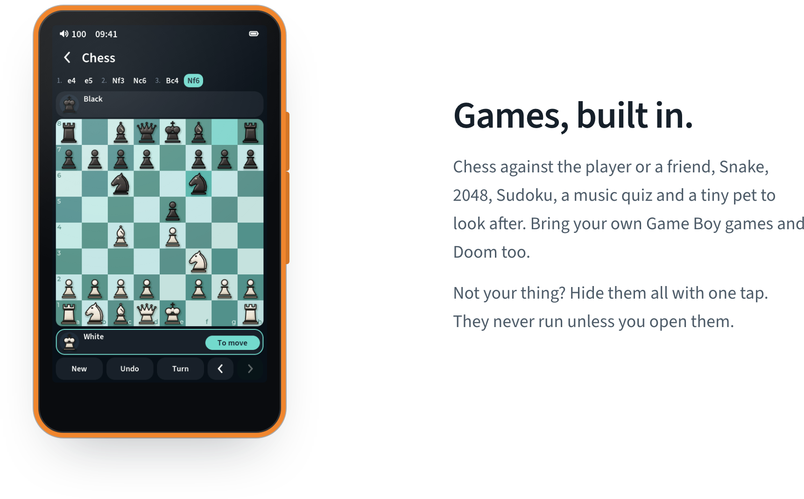

  

<a href="https://github.com/BlueDreams666/gabagoolOS/releases/latest">
<picture>
  <source media="(prefers-color-scheme: dark)" srcset="assets/hero-dark.png">
  
</picture>
</a>

**[Download 1.2.1](https://github.com/BlueDreams666/gabagoolOS/releases/latest)** &nbsp;·&nbsp;
[Website](https://bluedreams666.github.io/gabagoolOS/) &nbsp;·&nbsp;
[How to install](#no-funny-business) &nbsp;·&nbsp;
[Questions](#you-got-questions) &nbsp;·&nbsp;
[r/GabagoolOS](https://www.reddit.com/r/GabagoolOS/)

The HiBy R1 is a lovely little music player. Tiny, colourful, sounds great.
The software? Not so much. So we made new software for it.

GabagoolOS is fast, pretty and packed: smooth scrolling even with a huge
library, lyrics that follow the song, a real equalizer, radio, podcasts,
audiobooks and more. It lives on your SD card, never touches your music, and
the original HiBy software is always one button away.

## the main course

<picture>
  <source media="(prefers-color-scheme: dark)" srcset="assets/main-queue-dark.png">
  
</picture>

<picture>
  <source media="(prefers-color-scheme: dark)" srcset="assets/main-crossfade-dark.png">
  
</picture>

<picture>
  <source media="(prefers-color-scheme: dark)" srcset="assets/main-coverflow-dark.png">
  
</picture>

<picture>
  <source media="(prefers-color-scheme: dark)" srcset="assets/main-games-dark.png">
  
</picture>

## made fresh daily

Everything you'd want from a music player, and it's quick.

<picture>
  <source media="(prefers-color-scheme: dark)" srcset="assets/fresh-dark.png">
  
</picture>

<picture>
  <source media="(prefers-color-scheme: dark)" srcset="assets/menu-dark.png">
  
</picture>

Oh, and there are games. 2048, Sudoku, Snake, chess, a tiny pet, a music quiz,
even Doom and Game Boy. Not your thing? Hide them with one tap.

## the house special

## today's specials

New in 1.2: it updates itself over Wi-Fi, so this is the last time you
install by hand. Plus the Arcade held sideways, a smoother Snake and
steadier Bluetooth.

<picture>
  <source media="(prefers-color-scheme: dark)" srcset="assets/case-new-dark.png">
  
</picture>

## from the display case

Real screens from the real thing. No mock-ups.

<picture>
  <source media="(prefers-color-scheme: dark)" srcset="assets/case-homes-dark.png">
  
</picture>

<picture>
  <source media="(prefers-color-scheme: dark)" srcset="assets/case-listen-dark.png">
  
</picture>

<picture>
  <source media="(prefers-color-scheme: dark)" srcset="assets/case-more-dark.png">
  
</picture>

## we keep the books

We test every screen so you don't run into anything weird.

<picture>
  <source media="(prefers-color-scheme: dark)" srcset="assets/books-dark.png">
  
</picture>

## no funny business

Three steps, about ten minutes. Back up your card first, just in case.

1. **Download** `GabagoolOS-1.2.1-HiBy-R1.zip` and `GabagoolOS-1.2.1-boot-menu.upt`
   from the [latest release](https://github.com/BlueDreams666/gabagoolOS/releases/latest).
2. **Copy them to your card.** Unzip the zip onto the card. Put the `.upt` file
   on the card too, and rename it `r1.upt`.
3. **On the R1,** go to System > Firmware update > Via SD card.

Done! Your R1 now starts in GabagoolOS, and from now on it updates itself
over Wi-Fi. Want the HiBy software instead? **Hold Volume Down while you turn
it on.** Stuck? The release has a longer guide.

### changed your mind? forget about it

No hard feelings. Copy HiBy's own firmware to your card as `r1.upt`, hold
Volume Down while you turn the R1 on, and run the update from the HiBy menu.
Delete the `.rockbox` folder if you want the space back. Your music stays put.

## you got questions?

<b>Is it Rockbox?</b>

 

Under the hood, yes! [Rockbox](https://www.rockbox.org) has powered music
players for over twenty years and handles the playback. GabagoolOS is the
brand new touch interface on top, made for the R1.

<b>Was AI used to help build this?</b>

 

Yes. We test it a lot: every screen, in every language and text size, plus
thousands of random taps hunting for crashes. And the code is open for anyone
to read.

<b>Is it safe?</b>

 

As safe as these things get. GabagoolOS lives on your SD card and doesn't
mess with the R1's built-in software. The boot menu is HiBy's own update with
a small menu added, installed by HiBy's own updater. And you can always go
back. Just keep HiBy's firmware file somewhere safe, like with any update.

<b>How do I go back to the original?</b>

 

Copy HiBy's own firmware to your card as `r1.upt`, hold Volume Down while you
turn the R1 on, and run the update from the HiBy menu. Delete the `.rockbox`
folder if you want the space back. No hard feelings.

<b>Which players does it work on?</b>

 

Just the HiBy R1 for now. Everything is made for its screen and buttons.

<b>My R1 is brand new. Will Wi-Fi work?</b>

 

The newest R1s have a different Wi-Fi chip we haven't tried yet. It should
work, and music plays either way, but please tell us how it goes!

<b>Does it phone home?</b>

 

Nope. No tracking, no accounts, no ads. It only goes online when you turn on
Wi-Fi and use something that needs the internet, like lyrics, radio, podcasts
or album covers. The full list is in [NOTICE.md](NOTICE.md).

<b>Why "gabagool"?</b>

 

It's how they say "capicola" in *The Sopranos*. Find the house special tile on
your home screen and give it a tap. Ova haaaa!

<b>Something broke. Now what?</b>

 

Sorry about that! [Tell us on GitHub](https://github.com/BlueDreams666/gabagoolOS/issues/new/choose),
and attach the log file from your card (`.rockbox/sloppy/sloppy.log`). It
helps a lot.

## the family

Big thanks to the people and projects this is built on:

- **[sloppyjoo](https://github.com/sloppyjoo)**, who helped make GabagoolOS
- **[Rockbox](https://www.rockbox.org)**, which plays your music
- **[WillNHT's R1 port](https://github.com/WillNHT/rockbox-hiby-r1)** and
  **[bahusoid's Audiobook Mod](https://github.com/bahusoid/rockbox)**, where
  GabagoolOS started
- **[LVGL](https://lvgl.io)**, which draws everything you see
- **LRCLIB** for lyrics, **MusicBrainz** for covers, **radio-browser** for
  stations and **AutoEq** for headphone presets

The full list, with licences, is in [NOTICE.md](NOTICE.md).

## licence

Open source under the GPL (v2 or later), just like Rockbox. See [LICENSE](LICENSE).

 

  Made by fans. Not made by or affiliated with HiBy, HBO or <i>The Sopranos</i>. 
  Installing custom firmware is at your own risk.

