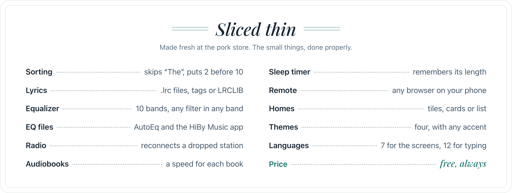

<a href="https://github.com/BlueDreams666/gabagoolOS/releases/latest">
<picture>
  <source media="(prefers-color-scheme: dark)" srcset="assets/hero-dark.png">
  
</picture>
</a>

**[Download 1.1](https://github.com/BlueDreams666/gabagoolOS/releases/latest)** &nbsp;·&nbsp;
[Website](https://bluedreams666.github.io/gabagoolOS/) &nbsp;·&nbsp;
[How to install](#no-funny-business) &nbsp;·&nbsp;
[Questions](#you-got-questions)

GabagoolOS replaces the R1's screens with its own: a tile, card or list home, a
library that stays smooth at tens of thousands of songs, Now Playing with synced
lyrics, a parametric equalizer with AutoEq, internet radio, podcasts,
audiobooks, e-books, your own Navidrome or Audiobookshelf server, Bluetooth and
AirPlay. It runs from the SD card, never changes your music, and the stock HiBy
player stays one button away.

## made fresh daily

Everything you reach for on a music player, made quick and calm.

<picture>
  <source media="(prefers-color-scheme: dark)" srcset="assets/fresh-dark.png">
  
</picture>

<picture>
  <source media="(prefers-color-scheme: dark)" srcset="assets/menu-dark.png">
  
</picture>

On the side, if you want them: 2048, Sudoku, 24 Points, Snake, chess, a pocket
pet, a music quiz, and Doom and Game Boy games in the Arcade (bring your own
cartridges). None of it runs unless you open it, and you can hide any of it.

## the house special

## today's specials

New in 1.1: a deck that learns your taste, a waveform to seek by, podcasts,
your own Navidrome or Subsonic server, an e-book reader, Audiobookshelf sync,
Last.fm scrobbling, a control centre you arrange yourself, and a phone remote
that pairs with a code.

<picture>
  <source media="(prefers-color-scheme: dark)" srcset="assets/case-new-dark.png">
  
</picture>

## from the display case

Every picture here is a real GabagoolOS screen at the R1's 480 × 800, saved by
its own test harness. No mock-ups. The covers are the harness's plain test art.

<picture>
  <source media="(prefers-color-scheme: dark)" srcset="assets/case-homes-dark.png">
  
</picture>

<picture>
  <source media="(prefers-color-scheme: dark)" srcset="assets/case-listen-dark.png">
  
</picture>

<picture>
  <source media="(prefers-color-scheme: dark)" srcset="assets/case-more-dark.png">
  
</picture>

## we keep the books

Built with AI help, and checked the boring way, on two R1s in daily use.

<picture>
  <source media="(prefers-color-scheme: dark)" srcset="assets/books-dark.png">
  
</picture>

## no funny business

The full guide, with every step and what each file does, is in the README that
comes with [each release](https://github.com/BlueDreams666/gabagoolOS/releases/latest).
Read it before you flash anything. In short:

1. **Get ready.** Charge to 50%, back up the card, and download HiBy's official
   R1 firmware from HiBy's help centre. That file is your way back.
2. **Boot menu, once.** Move any other `.upt` files off the card. Copy
   `GabagoolOS-1.1-boot-menu.upt` to the card root as `r1.upt`, then in the HiBy
   player run System > Firmware update > Via SD card.
3. **Copy GabagoolOS.** Unzip `GabagoolOS-1.1-HiBy-R1.zip` onto the card root (it
   adds a hidden `.rockbox` folder and a `Games` folder) and restart.

The R1 then starts straight into GabagoolOS. **Hold Volume Down while you power
on** to choose the HiBy player instead.

### changed your mind? forget about it

1. Copy HiBy's official 2.0 or 1.6 file to the card root as `r1.upt`.
2. Hold Volume Down at power-on, open the HiBy player, and run
   System > Firmware update > Via SD card.
3. Delete the `.rockbox` folder if you want the space back. Your music is never
   touched.

## you got questions?

<b>Is it Rockbox?</b>

 

It is built on [Rockbox](https://www.rockbox.org), the open-source player
firmware that has run on music players for over twenty years. Rockbox does the
playback, codecs, DSP and database. GabagoolOS is a new touch interface on top,
drawn with LVGL, plus R1 device work, starting from WillNHT's R1 fork and
bahusoid's Audiobook Mod. It is GPL v2 or later, like Rockbox.

<b>Was it made with AI?</b>

 

Yes. GabagoolOS was written with a lot of help from AI coding tools,
directed, reviewed and tested by people on real R1s in daily use. We'd rather say
so than have you guess. What matters is whether it works, so it is tested the
boring way:

- **A screen audit.** A harness drives every screen in every theme, language and
  text size, 32,256 screens in 196 combinations, and fails on anything clipped,
  overlapping, too faint or too small to tap. The current count is zero.
- **Fuzzing.** Random taps, swipes and key presses across every screen, many
  seeds, looking for crashes and hangs.
- **AddressSanitizer.** The whole interface runs under ASan to catch memory
  errors before they reach a player.
- **DSP proofs.** The new equalizer is checked numerically against Rockbox's
  original filters and a double-precision reference at four sample rates.

The code will be here for anyone to read.

<b>Why "gabagool"?</b>

 

It's capicola, the way they say it in *The Sopranos*. Tap the house special
tile on the Tiles home. Ova haaaa!

<b>Is it safe to install?</b>

 

GabagoolOS itself lives on the SD card, in a `.rockbox` folder, and doesn't
write to the R1's internal memory. The boot menu is HiBy's own firmware 2.0
update with three small additions (the boot menu, a script that mounts the card,
and a boot logo). Like any official update it holds only the kernel, byte for
byte HiBy's, and the system image. There is no recovery or bootloader image in
it, and HiBy's own updater installs it. While the R1 is plugged into a computer
in USB mode, GabagoolOS writes nothing to the card. Updates on the player only
install if they carry the release signature. Flashing firmware always carries
some risk, so keep HiBy's official file to hand.

<b>Which players does it support?</b>

 

The HiBy R1 only. It is made for the R1's 480 × 800 screen, its buttons and its
hardware. Newer R1s with the AIC8800 wireless chip are supported through HiBy
2.0's own drivers; that path hasn't yet run on one of those units, so reports
are welcome. Playback and everything else don't depend on the wireless chip.

<b>Does it phone home?</b>

 

No. It goes online only when you turn on Wi-Fi and use a feature that needs it:
lyrics (LRCLIB), covers (MusicBrainz and the Cover Art Archive), internet radio
(radio-browser, and ip-api.com for "near you"), podcasts (Apple's directory and
the feeds you add), AutoEq profiles (GitHub), scrobbling (Last.fm or
ListenBrainz, your own account), your own Navidrome or Audiobookshelf server,
and the clock (NTP). The phone remote only answers phones you've paired.

<b>Something went wrong. What should I send?</b>

 

[Open an issue](https://github.com/BlueDreams666/gabagoolOS/issues/new/choose)
with your R1's HiBy firmware (1.6 or 2.0, shown in the boot menu), the
GabagoolOS version, and `.rockbox/sloppy/sloppy.log` from the card.

## the family

GabagoolOS stands on the work of many people:

- **[Rockbox](https://www.rockbox.org)** (GPL v2+): playback, codecs, DSP, the
  database, plugins, Doom and the Game Boy core.
- **[Rockbox for the HiBy R1](https://github.com/WillNHT/rockbox-hiby-r1)** by
  WillNHT, built on **[bahusoid's Rockbox Audiobook Mod](https://github.com/bahusoid/rockbox)**:
  the R1 port, the audiobook library and many device fixes.
- **[LVGL](https://lvgl.io)** (MIT), which draws the interface, with lodepng
  (zlib) and stb_image. For internet radio, **libmad** and **FAAD2** (GPL), and
  Rockbox's copies of **Tremor** and **libopus** (BSD) and its FLAC decoder
  (LGPL).
- Fonts under the SIL Open Font License: **Source Sans 3**, **Shrikhand**,
  **Noto Sans** Hebrew, Arabic, SC, KR and Thai, and **Montserrat** for symbols.
- **LRCLIB** for lyrics, **MusicBrainz** and the **Cover Art Archive** for
  covers, **radio-browser** for stations, **AutoEq** by Jaakko Pasanen for
  headphone profiles, **Last.fm** and **ListenBrainz**, and the **Unicode
  Unihan** database for the pinyin keyboard.

Everything, with licences, is in [NOTICE.md](NOTICE.md).

## licence

GabagoolOS is free software under the GNU General Public License, version 2 or
(at your option) any later version, like Rockbox. See [LICENSE](LICENSE).

 

  GabagoolOS is a fan project. It is not made or supported by HiBy, and has nothing to do with HBO or <i>The Sopranos</i>. 
  Flashing firmware is at your own risk; keep HiBy's official file to hand.

